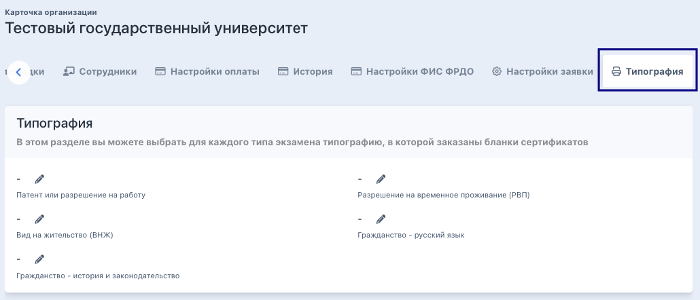

Периодически организации могут использовать разные бланки для разных уровней экзамена. Для такой настройки добавлена вкладка «Типография» в карточку организации.

{width=1030px height=442px}

Здесь можно выбрать для каждого типа экзамена типографию, в которой заказаны бланки сертификатов. по нажатию на любой карандашик откроется окно с подтверждением, что на самом деле необходимо изменить типографию.

{width=676px height=319px}

После сохранения выбранного варианта система отображает его для того экзамена, для которого была произведена настройка.
