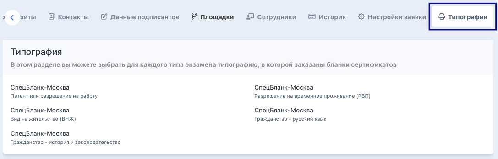

Периодически организации могут использовать разные бланки для разных уровней экзамена. Для такой настройки добавлена возможность выбрать типографию для каждого отдельного типа экзамена.

Сделать это можно по запросу через [техническую поддержку ](https://forms.yandex.ru/cloud/662cbe9243f74fea695ffa27/)платформы.

Отображаться эта информация будет на вкладке «Типография» в карточке организации (у пользователей, которые имеют к ней доступ).

{width=1087px height=348px}

После сохранения выбранного варианта типографии система отображает его для того экзамена, для которого была произведена настройка.
