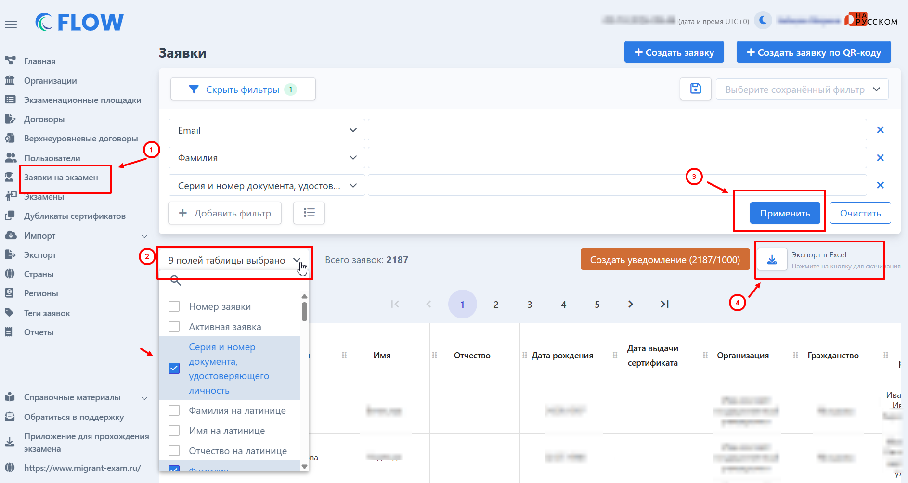

В адрес центров тестирования поступают запросы от Минобрнауки в соответствии с письмом "О предоставлении информации в рамках соглашения «Антитеррор» от 05.10.2026 № МН-6/2271.

[05\.10.2026_О предоставлении информации в рамках соглашения «Антитеррор».pdf](<./05.10.2026_О предоставлении информации в рамках соглашения «Антитеррор».pdf>)

Центры тестирования могут самостоятельно выгрузить все необходимые сведения по данному запросу в системе Flow.

Сведения должны быть предоставлены по форме, которая представляет собой таблицу со следующими столбцами: Фамилия, Имя, Отчество, Дата рождения, Место рождения, Гражданство, Паспортные данные, Год получения сертификата, Образовательная организация, Место регистрации/нахождения.

[Форма.xls](./Форма.xls)

Все эти сведения можно получить c помощью выгрузки во Flow на странице "Заявки на экзамен». Для этого выберите все необходимые столбцы, которые есть в таблице запроса, с ненужных снимите галочки. Когда выберете все необходимые столбцы, нажмите "Применить".

{width=1886px height=1004px}

Сформированную табличку выгрузите в формате Excel.
